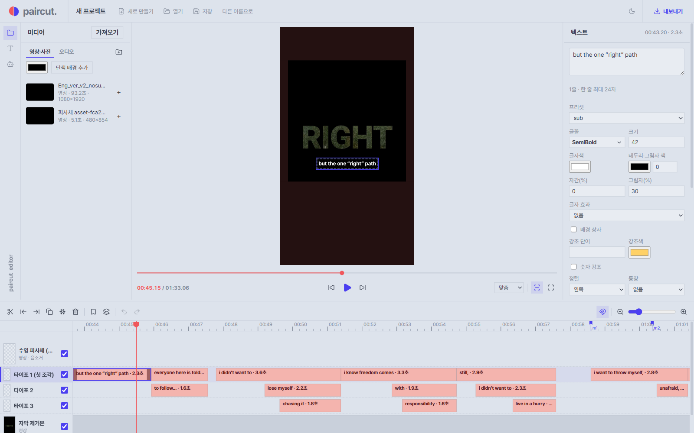
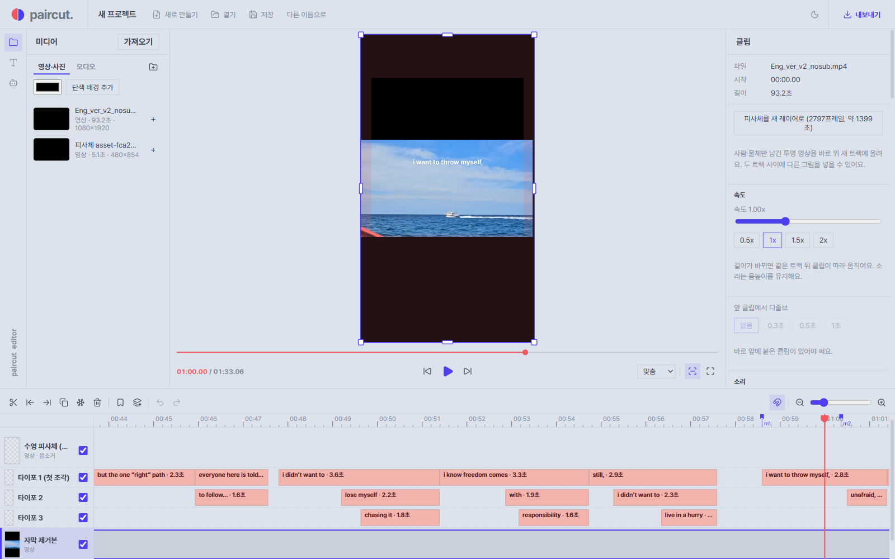
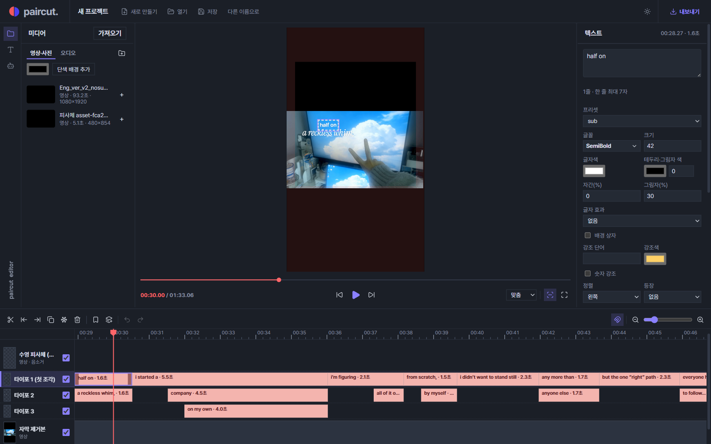

# 페어컷 paircut

릴스(9:16)를 편집하는 Windows 데스크톱 편집기. CapCut의 작업 흐름을 따르되, 인스타그램 캐릭터 계정 [빛뜰](https://www.instagram.com/windgarden_gardener/)의 릴스 제작에 맞춰 만들었다.

<p>
  
</p>
<p>
  
  
</p>

## 할 수 있는 것

1. **컷 편집**: 다중 트랙, 이동·트림·분할, 자석, 박스 선택, 되돌리기, MP4 내보내기. 화면 비율 9:16·16:9·1:1·4:5
2. **텍스트·자막**: 프리셋과 템플릿, 글자 일부만 꾸미기, 글자 효과(반전·흑백 창·유리 창·뚫린 글자·글로우·색수차·글리치), 피사체 뒤 글자, SRT 가져오기·내보내기
3. **오디오·속도**: 클립 볼륨 0~200%, 페이드, 0.5~2배속(음높이 유지), CC0 효과음 20개
4. **색 보정**: 사진 앱식 조정 11개, 비네트, 디테일, 렌즈 효과(블러·소프트 글로우·할레이션·빛줄기), 필터 9종, 자동 보정, 보정 프리셋
5. **전환·합성**: 크로스 디졸브, 키프레임, 투명 배경 webm, 피사체를 새 레이어로 분리(rembg)
6. **앱 안 Claude**: 사이드 패널에서 Claude Agent SDK로 편집을 맡긴다. 도구는 상태 읽기·편집·미리보기 캡처·창 캡처 4개뿐이고, 저장·내보내기는 맡기지 않는다
7. **로컬 브릿지**: 실행 중인 편집기 창을 Claude Code가 바깥에서 읽고 고친다(`scripts/bridge.mjs`). 사람과 에이전트가 같은 프로젝트를 동시에 편집한다

## 미리보기와 내보내기가 같은 픽셀

미리보기는 캔버스와 WebGL, 내보내기는 ffmpeg로 따로 그리지만 계산은 한 곳에서 한다.

- 배치: `shared/project.ts`의 `placeVisual` 하나를 양쪽이 쓴다
- 색 보정: `shared/color.ts`의 `gradePixel`을 33³ 3D LUT로 구워, 미리보기는 WebGL2 3D 텍스처, 내보내기는 `.cube` + `lut3d`
- 텍스트: 렌더러 캔버스가 그린 같은 비트맵을 미리보기에 쓰고, 내보내기에는 PNG로 넘긴다

## 검증

```
npm test        # 빌드 + scripts/e2e-export.mjs + scripts/e2e-ui.mjs
npm run typecheck
npm run lint
```

- `e2e-export.mjs`: 실제 ffmpeg로 내보낸 파일의 픽셀과 음량을 검사한다
- `e2e-ui.mjs`: Playwright로 Electron 앱을 띄워 미리보기 캔버스와 내보낸 프레임을 비교한다(텍스트·색 보정·디졸브 포함). 분할·되돌리기·드래그·트림, SRT, 속도·볼륨·페이드도 여기서 확인한다
- 앱 안 Claude 도구는 모델 호출 없이 main 프로세스에서 직접 불러 검증한다

## 실행

Windows, Node.js, ffmpeg가 필요하다. ffmpeg는 PATH에서 찾고, 다른 경로는 `PAIRCUT_FFMPEG`로 지정한다. 피사체 분리는 Python과 rembg가 필요하다(`PAIRCUT_PYTHON`).

```
npm install
npm start
```

## 만든 방법

| 영역 | 도구 |
|---|---|
| 앱 | Electron, React, TypeScript, zustand |
| 미리보기 | Canvas 2D, WebGL2, WebAudio |
| 내보내기 | ffmpeg `filter_complex` |
| 피사체 분리 | Python, rembg |
| 앱 안 Claude | Claude Agent SDK |
| 테스트 | Playwright(Electron), 실제 ffmpeg 출력 비교 |
| 개발 | Claude Code |

## 폴더

```
electron/   main 프로세스: 내보내기, 미디어, 브릿지, 앱 안 Claude
src/        렌더러: 화면, 미리보기 엔진(src/engine), 글꼴
shared/     미리보기와 내보내기가 같이 쓰는 계산(배치, 색, 필터 그래프)
scripts/    e2e 테스트, 브릿지 클라이언트
tools/      피사체 분리(matte.py)
brand/      로고·아이콘 생성(make.py)
sfx/        CC0 효과음과 출처(sfx.json)
PLAN.md     기능 계획과 결정 기록
```

## 알려진 한계

- 아이폰 HDR(HLG·돌비비전) 영상은 미리보기와 내보내기 색이 다를 수 있다(톤매핑 미처리)
- 영상 구간으로 재생 헤드를 옮기면 미리보기가 약 0.4초 늦게 바뀐다

## 에셋 라이선스

글꼴은 SIL OFL 1.1(Rock Salt는 Apache 2.0), 효과음은 CC0이다. 각 라이선스 파일은 `src/fonts/`와 `sfx/`에 있다.

## 사람

기획, 디자인, 개발을 한 사람이 Claude Code와 함께 했다.
